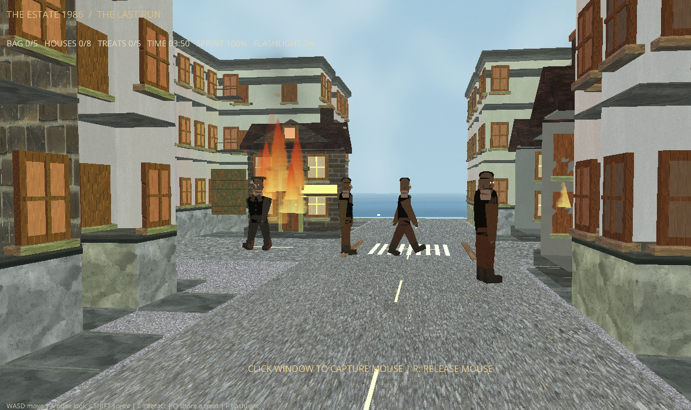

# Halloween Game

A first-person 3D game built with Python and Ursina. The project includes its textures and other game assets.



## Download

You can either:

- Download the project as a ZIP from the [GitHub repository](https://github.com/rb-software/Halloween_game) using **Code → Download ZIP**, then extract it; or
- Clone it with Git:

  ```bash
  git clone https://github.com/rb-software/Halloween_game.git
  cd Halloween_game
  ```

For a ZIP download, open a terminal in the extracted project folder—the one containing `run_game.py` and `requirements.txt`.

## Requirements

- Python 3.9 or newer
- A desktop environment with graphics support
- Git, if you are cloning the repository

## Install and run

Create a virtual environment, install the project dependencies, and start the game from the project folder.

### macOS and Linux

```bash
python3 -m venv .venv
source .venv/bin/activate
python -m pip install --upgrade pip
python -m pip install -r requirements.txt
python run_game.py
```

The game prints the graphics renderer and vendor reported by Panda3D at startup. On macOS, the operating system chooses the physical GPU for a Python script; the game cannot force a particular GPU unless it is packaged as an app with the appropriate `Info.plist` setting.

To exit the virtual environment after closing the game, run:

```bash
deactivate
```

### Windows (PowerShell)

```powershell
py -3 -m venv .venv
.\.venv\Scripts\Activate.ps1
python -m pip install --upgrade pip
python -m pip install -r requirements.txt
python run_game.py
```

If PowerShell blocks activation scripts, allow it for the current terminal session, then activate the environment again:

```powershell
Set-ExecutionPolicy -Scope Process -ExecutionPolicy Bypass
.\.venv\Scripts\Activate.ps1
```

## Optional AI neighbor

The game works without an API key and uses its local neighbor AI. To enable the optional OpenAI-powered neighbor, set `OPENAI_API_KEY` in your terminal before starting the game. You can also set `OPENAI_MODEL`; it defaults to `gpt-4o-mini`.

macOS/Linux:

```bash
export OPENAI_API_KEY="your-api-key"
python run_game.py
```

Windows PowerShell:

```powershell
$env:OPENAI_API_KEY = "your-api-key"
python run_game.py
```

Do not commit or share your API key.

## Controls

The game hides and confines the mouse cursor to its window on startup. While captured, the cursor is continuously recentered so you can turn the camera without hitting the window edge. Press `R` to release the cursor to the system; click inside the game window to capture it again.

| Key | Action |
| --- | --- |
| W / A / S / D or arrow keys | Move |
| Mouse | Look around |
| Shift | Sprint |
| E | Collect packages, return them at the Package Return station, or interact |
| Q | Share an item |
| F | Toggle the flashlight |
| P | Toggle the visual-quality mode |
| Tab | Show or hide the map |
| U | Toggle ambient audio |
| R | Release the mouse cursor to the system |
| Click the game window | Capture the mouse again |
| Enter | Restart after the game ends |
| Esc | Quit |

Saluting neighbors may receive a super package from the officer. Collect it for
four-times movement speed for 12 seconds.

## Asset licenses

The textures in `assets/textures/ambientcg/` are from ambientCG and are released under CC0 1.0 Universal. Source links and details are documented in [SOURCES.txt](assets/textures/ambientcg/SOURCES.txt).

The modified sky texture is used under the [Unsplash License](https://unsplash.com/license). Source details are in [milky_way_unsplash.txt](assets/textures/milky_way_unsplash.txt).

The source code has no license; the textures' CC0 license does not apply to it. Dependencies have separate licenses.

## Code quality checks

Install Ruff in your development environment and run the configured checks from the project directory:

```bash
python -m pip install ruff
ruff check .
ruff format --check .
python -m unittest discover -s tests -v
```
